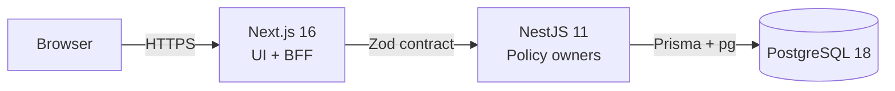
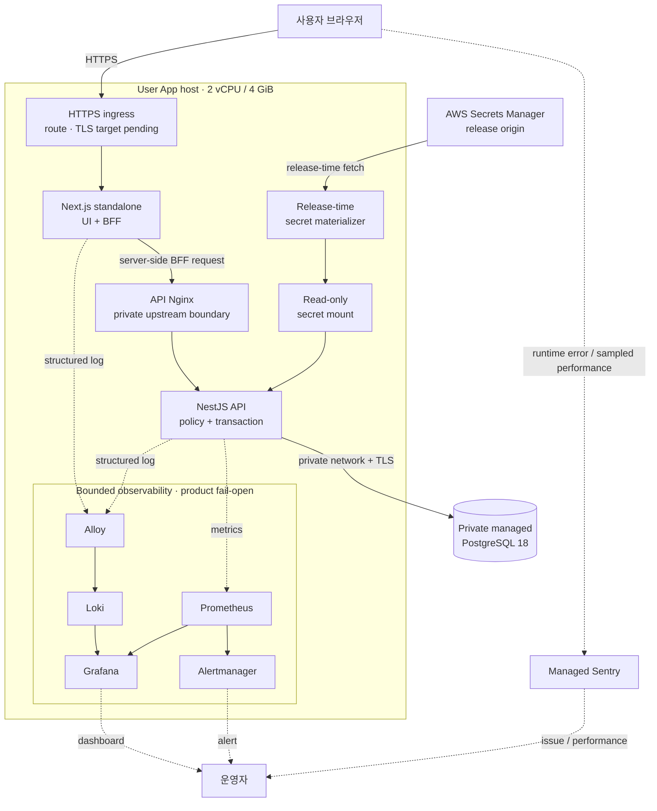

# KNU Roommate

강원대학교 재학생이 **생활패턴이 맞는 기숙사 룸메이트를 탐색하고, 대화와 매칭 요청으로 한 학기의 룸메이트를 결정하도록 돕는 시즌 기반 웹 서비스**입니다.

> **현재 상태**: Pre-release · 제품 코드와 자동 검증·로컬 인프라 리허설 경로 구현 · 실제 사용자 및 production target 검증 대기

[서비스 자세히 보기](./SERVICE.md) · [제품 정책](./docs/policies/README.md) · [아키텍처](./docs/architecture/README.md) · [기여 안내](./CONTRIBUTING.md) · [운영 Runbook](./infra/runbooks/README.md)

## 해결하려는 문제

기숙사 룸메이트는 한 학기의 생활 만족도에 큰 영향을 주지만, 후보를 찾는 과정은 단체 채팅방·커뮤니티·지인 소개처럼 파편화된 채널에 의존하기 쉽습니다.

- 수면, 흡연, 통화, 청결, 실내 취식 같은 생활 마찰 요소를 구조적으로 비교하기 어렵습니다.
- 재학생 여부, 같은 기숙사 배정, 현재 매칭 가능 시점을 함께 확인하기 어렵습니다.
- 대화·요청·수락·매칭 해제·과거 이력이 서로 다른 채널에 흩어집니다.
- 신고, 차단, 탈퇴 후 비식별화처럼 서비스 운영에 필요한 안전 경계가 약합니다.

KNU Roommate는 이를 **학교 이메일 인증 → 시즌 등록 → 생활패턴 기반 후보 탐색 → 대화와 매칭 → 시즌 이력 확인**이라는 하나의 흐름으로 연결합니다. 학교의 기숙사 배정이나 호실 선택을 대신하지 않고, 그 전에 필요한 룸메이트 탐색과 합의를 돕는 것이 제품 경계입니다.

## Portfolio Highlights

| 관점                  | 이 저장소에서 확인할 수 있는 것                                                                                                |
| --------------------- | ------------------------------------------------------------------------------------------------------------------------------ |
| Policy-first          | 화면보다 먼저 시즌·등록·공개 범위·매칭·채팅·보존 정책을 정의하고 domain model과 API contract로 연결했습니다.                   |
| Full-stack ownership  | Next.js UI/BFF, shared Zod contract, NestJS policy owner, Prisma/PostgreSQL transaction을 한 저장소에서 일관되게 설계했습니다. |
| Safe change           | lint·typecheck·unit·integration·E2E·stress harness·repo policy test를 책임별 lane으로 분리하고 변경 경로에 맞춰 실행합니다.    |
| Operational readiness | 제한된 서버 자원, secret 전달, migration, rollback, log·metric·browser error 관측을 기능 개발과 함께 설계했습니다.             |
| Agentic development   | AI agent를 구현 가속기로 사용하되 정책 결정, trade-off 선택, diff 검토와 완료 판정은 사람이 소유했습니다.                      |

## 사용자 여정

```text
학교 이메일 인증
  → 계정과 학적 정보 생성
  → 현재 시즌 확인
  → 기숙사·생활패턴 입력과 시즌 등록
  → 같은 조건의 후보 탐색
  → 프로필 비교와 대화
  → 매칭 요청·수락
  → 현재 매칭 관리와 시즌 이력 확인
```

가입과 시즌 참여는 같은 상태가 아닙니다. 계정이 있어도 현재 시즌, 필수 프로필, 기숙사 선택과 등록 transaction이 완료되어야 탐색·상세·매칭 action이 열립니다. UI는 이 조건을 자체 추측하지 않고 서버가 계산한 capability와 reason을 표현합니다.

## Architecture at a Glance

### Logical application flow



사용자 화면과 BFF는 Web이 소유하고, 정책과 transaction의 최종 판단은 API와 PostgreSQL이 소유합니다. `packages/shared`의 Zod contract는 이 경계를 런타임 검증 가능한 타입으로 연결합니다.

### Expected deployment topology

아래 구성은 **실제 배포 완료도가 아니라 release 전 계획과 local rehearsal의 기준**입니다. Public ingress의 최종 TLS 종료·route, provider identifier와 network는 production target에서 검증해 release evidence로 확정합니다.



- 브라우저의 일반 UI·BFF 요청은 Next.js로 들어가고, BFF가 private API Nginx를 통해 NestJS를 호출합니다.
- API는 private managed PostgreSQL에 연결하며 DB를 User App host의 4 GiB resource budget에 포함하지 않습니다.
- production secret은 image나 Git에 넣지 않고 release 시점에 받아 read-only file로 API container에 제공합니다.
- 로그·metric·browser signal은 각각 Loki·Prometheus·Sentry로 분리하고 관측 장애가 제품 요청을 막지 않게 합니다.

### 경계 원칙

- **Web**은 사용자 interaction과 BFF transport를 소유하지만 정책 authority를 복제하지 않습니다.
- **Shared contract**는 FE/BE request·response와 enum을 런타임 검증 가능한 타입으로 연결합니다.
- **API owner**는 action capability, transaction precondition과 terminal reason을 계산합니다.
- **PostgreSQL**은 unique constraint와 transaction으로 최종 경쟁 상태를 판정합니다.
- **관측 데이터**는 장애·성능 분석에 사용하며, 매칭 성공률 같은 제품 분석 데이터와 분리합니다.

## 대표 의사결정

### 1. 화면 상태가 아니라 시즌 참여 aggregate를 기준으로 삼았습니다

초기 prototype에서는 `User`와 화면별 boolean이 가입, 시즌 준비, 공개 여부와 매칭 가능 여부를 함께 표현했습니다. 작은 정책 변경이 여러 화면과 API를 서로 다르게 해석하는 문제가 생겼습니다.

이를 다음 책임으로 분리했습니다.

- `User`: 로그인 가능한 계정
- `UserDisplayIdentity` / `UserAcademicIdentity`: 표시·학업 identity
- `SeasonParticipant`: 특정 시즌 참여 anchor
- 시즌 프로필·기숙사 선택: 등록 전 draft
- registration finalize: 공개 가능한 참여 상태와 이력 snapshot을 함께 확정하는 transaction

탐색·상세·매칭·채팅은 `SeasonParticipant`와 서버 capability를 기준으로 판단합니다. 이 결정은 [시즌 참여 정책](./docs/policies/season-participation.md), [룸메이트 탐색 정책](./docs/policies/roommate-searching.md), [action capability 설계](./docs/architecture/frontend/action-capability-source-of-truth.md)로 이어집니다.

### 2. 사전 확인 API와 최종 transaction의 책임을 분리했습니다

회원가입 닉네임 확인은 빠른 사용자 feedback을 제공하지만, 확인 직후 다른 사용자가 같은 값을 선점할 수 있습니다. 따라서 사전 확인 성공을 예약으로 간주하지 않습니다.

- 닉네임 전용 validation API는 형식·금칙어·현재 중복 상태를 안내합니다.
- 실제 회원가입 transaction은 같은 정책을 다시 검증합니다.
- 최종 uniqueness는 DB constraint가 판정합니다.
- 경쟁 상태가 발생하면 UI는 닉네임 입력 단계로 돌아가 다시 확인하도록 안내합니다.

인증도 같은 원칙을 적용했습니다. 목적과 사용자에게 묶인 single-use grant, Argon2id 비밀번호, DB-backed opaque access/renewal session과 rotation/revoke 경계를 사용합니다. 상세 근거는 [계정 인증 정책](./docs/policies/account-authentication.md)과 [opaque session 결정](./docs/architecture/backend/auth/jwt-vs-opaque-session-transport-decision.md)에 있습니다.

### 3. 서버 크기보다 먼저 resource owner와 실패 경계를 설계했습니다

배포 전 계획·리허설 기준은 **2 vCPU / 4 GiB User App host + private managed PostgreSQL 18**입니다. User host에는 nginx, Web, API와 bounded observability stack을 두고 제품 container limit 합계는 2,976 MiB로 제한해 OS·Docker·filesystem cache와 순간 부하를 위한 약 1.1 GiB를 남깁니다.

이 구성을 선택한 이유는 다음과 같습니다.

- 초기 사용자 규모에서 비용과 운영 복잡도를 제한합니다.
- Argon2id와 제품 transaction을 관측 도구보다 우선하는 resource owner로 둡니다.
- Loki, Prometheus, Grafana 장애가 사용자 요청을 막지 않도록 fail-open으로 구성합니다.
- 미래 BackOffice는 8 GiB 단일 host에 합치지 않고 별도 2 GiB host로 분리해 operator ingress, 배포와 장애 영역을 격리합니다.

이는 실제 운영 성능을 주장하는 수치가 아닙니다. 현재 저장소는 2 CPU / 4 GiB 제품 envelope와 외부 DB를 흉내 내는 disposable PostgreSQL fixture로 연결·migration·resource·관측 장애 격리를 리허설합니다. 실제 provider, region, 네트워크, RDS latency와 가격은 release 시점의 evidence로 다시 확인해야 합니다. 자세한 근거는 [production runtime topology](./docs/architecture/platform/production-runtime-topology.md)와 [release readiness](./infra/runbooks/release/components/infrastructure-target/readiness.md)에 있습니다.

## Agentic Development Workflow

이 프로젝트는 1인 개발로 진행하며 Codex 기반 AI agent를 분석·구현·검증 보조 도구로 사용했습니다. 목표는 많은 코드를 생성하는 것이 아니라, 혼자 개발할 때 놓치기 쉬운 정책 충돌과 변경 영향을 반복해서 드러내고 **검증 가능한 근거로 결정하는 개발 체계**를 만드는 것이었습니다.

```text
사용자 문제와 제약 확인
  → 정책과 Open Question 정리
  → 대안·위험·test shape 검토
  → bounded implementation
  → code review와 regression 탐색
  → lint / typecheck / test / rehearsal
  → 결정과 운영 절차를 tracked 문서로 승격
```

| 책임      | 사람이 소유한 것                                                | AI agent가 보조한 것                                  |
| --------- | --------------------------------------------------------------- | ----------------------------------------------------- |
| 문제·정책 | 사용자 문제 정의, 허용 범위, 보안·개인정보 trade-off, 최종 결정 | 관련 코드 탐색, 충돌과 누락 질문 도출, 대안 비교      |
| 설계      | domain owner, contract와 transaction 경계, 채택·반려 판단       | 구조 초안, 영향 범위 지도, 외부 공식 자료 조사        |
| 구현      | 변경 범위 승인, 핵심 diff 검토, 완료 여부 판정                  | 반복 구현, fixture·test 보강, callsite relocation     |
| 품질      | acceptance criteria와 검증 수준 결정                            | static guard, 회귀 테스트, 실패 원인 탐색             |
| 운영      | 비용·위험 수용, 배포·rollback owner 결정                        | rehearsal harness, evidence template, stale 문서 탐색 |

### AI 출력을 통제한 방법

[Owner–Lead 협업 계약](./docs/development/agent-workflows/owner-lead-collaboration.md)은 중요한 제품·비용·위험 선택은 사람에게,
승인된 범위의 기술 판단·실행·결과 통합은 Parent Agent에게 둡니다. 매번 사람이 함수를 고르거나 고정된 Agent 팀을 가동하는 구조가 아닙니다.

```text
Human Owner ↔ Parent Agent / Lead
                ├─ 직접 조사·구현·검증 (기본)
                └─ 필요할 때 bounded specialist ↔ 결과·blocker 보고
                   탐색 / 조사 / 구현 / 독립 QA
```

업무 배정·범위 변경·최종 통합은 Parent가 소유합니다. Specialist 사이에는 Parent가 지정한 사실 확인만 예외적으로 허용하며,
업무 떠넘기기와 하위 Agent 생성은 금지합니다. 이는 지침 수준의 책임 구조이지 runtime의 강제 통신 차단이나 생산성 향상 측정 결과가 아닙니다.

제한된 synthetic 리허설에서는 직접 수정·중요한 선택의 보류·지정된 사실 교환·범위 밖 요청 거절을 관찰했습니다.
독립 QA가 찾은 테스트 누락과 보강 결과, 실제로 검증하지 못한 범위는
[협업 관찰 근거](./docs/development/agent-workflows/agentic-architecture-decisions.md#collaboration-observation--2026-09-10)에 구분했습니다.

1. **정책을 먼저 고정**해 화면이나 agent가 action 가능 여부를 임의로 만들지 못하게 했습니다.
2. **행동 변경과 구조 변경을 분리**하고, cleanup 전에는 기존 행동을 test로 잠갔습니다.
3. **결정적 오류는 static guard와 CI로 차단**하고, 의미·경계 문제는 review로 판단했습니다.
4. **실패한 검증을 완료로 포장하지 않고** blocker와 다음 evidence를 남겼습니다.
5. 임시 분석이 아니라 **제품 코드, test, 정책, architecture, runbook과 Git history**를 장기 handoff로 사용했습니다.

AI가 실제 팀 협업이나 production 운영 경험을 대신한다고 보지는 않습니다. 아직 실사용자 feedback, 실제 장애 대응과 운영 부하 증거는 없으며, README에서는 이를 구현·리허설 결과와 분리합니다.

SDD, Harness Engineering, Context Engineering, Human-governed Agentic Programming의 선택 이유와 현재 적용 수준은 [Agentic Engineering methodology](./docs/evidence/agent-workflows/agentic-engineering-methodology.md)에 정리했습니다.

이 접근은 AI 활용 자체보다 검증 체계를 강조하는 [Toss의 agent 품질 관리 사례](https://toss.tech/article/skill-quality-rubric), 변경 전 계획과 test 안전망을 강조하는 [Kakao의 AI 리팩터링 사례](https://tech.kakao.com/posts/729), AI가 기존 개발 체계의 강점과 약점을 증폭한다고 설명하는 [DORA 2025](https://dora.dev/research/2025/dora-report/)의 문제의식과 같은 방향입니다.

## Quality Evidence

테스트 파일 수보다 **어떤 위험을 어느 검증 계층이 책임지는지**를 기준으로 구성했습니다.

| 검증 계층                | 주요 책임                                                                         |
| ------------------------ | --------------------------------------------------------------------------------- |
| Repo policy              | source-of-truth 경계, 금지 경로, workflow·artifact·문서 책임 회귀 차단            |
| Shared                   | Zod contract와 domain constant의 타입·런타임 정합성                               |
| API unit                 | policy, command, query, presenter와 failure mapping                               |
| API integration/E2E      | PostgreSQL constraint·transaction, HTTP contract, auth/session과 domain lifecycle |
| API stress harness       | Argon2id, DB pool, admission과 Dockerized load scenario의 실행 가능성             |
| Web component/BFF        | UI state, 접근성, form recovery, BFF allowlist와 error mapping                    |
| Playwright               | desktop/mobile browser smoke와 주요 사용자 route                                  |
| Storybook                | 정책 상태별 PC/Mobile UI를 API 없이 비교하는 visual workshop                      |
| Infrastructure rehearsal | fresh migration, Web→API, metrics/log 수집, observability fail-open과 cleanup     |

Monorepo CI는 변경 경로를 Shared/API/Web/repo-policy로 분류합니다. Web-only 변경에 PostgreSQL lane을 실행하거나 API-only 변경에 browser lane을 실행하지 않으며, 선택된 lane 결과는 하나의 summary gate에서 fail-closed로 판정합니다. 설계와 측정 기준은 [Monorepo CI architecture](./docs/architecture/platform/monorepo-ci.md)에 있습니다.

## Operations & Observability

관측은 포트폴리오용 부가 기능이 아니라, 배포 후 유지보수에서 “사용자가 겪은 실패를 재현하고 변경의 영향을 판단하기 위한 제품 경계”로 설계했습니다.

| 신호                      | 수집·저장                                         | 확인 목적                                  |
| ------------------------- | ------------------------------------------------- | ------------------------------------------ |
| API/BFF structured log    | Pino/Web logger → Alloy → Loki → Grafana          | 요청 실패와 server-side 원인 탐색          |
| Runtime/domain metric     | `prom-client` → Prometheus → Grafana/Alertmanager | latency, saturation, failure trend와 alert |
| Browser error/performance | Sentry Next.js SDK → Managed Sentry               | 사용자 브라우저 오류와 Web Vital 회귀      |
| Managed DB resource       | CloudWatch/DB Insights                            | connection, CPU, memory, I/O 상태          |

관측 port는 public internet에 직접 노출하지 않고, 수집기 장애는 제품 요청에 대해 fail-open이어야 합니다. 로그와 metric은 사용자 행동 분석을 대신하지 않으며 개인정보·보존·접근 범위는 [운영 관측 정책](./docs/policies/operational-observability.md), 도구 책임은 [observability topology](./docs/architecture/platform/observability-topology.md)가 소유합니다.

## Evidence Status

| 항목                             | 상태                       | 의미                                                      |
| -------------------------------- | -------------------------- | --------------------------------------------------------- |
| 제품 기능·contract·DB baseline   | Implemented                | 저장소 코드와 자동 테스트로 검증 가능                     |
| Monorepo CI와 local verification | Implemented                | 변경 경로별 검증 command와 workflow 존재                  |
| Full-stack local rehearsal       | Rehearsal available        | 제한된 Docker 자원에서 재현 가능한 harness와 runbook 존재 |
| Production provider·DNS·TLS·RDS  | Pending release evidence   | 실제 계정·target에서 아직 검증하지 않음                   |
| 실사용자 UX·운영 지표            | Not yet available          | release와 사용자 검증 이후 측정 대상                      |
| BackOffice                       | Architecture decision only | 별도 host·deploy·authorization 경계만 결정, 제품 미구현   |

## Current Tech Stack

| 영역           | 현재 기준                                                           | 선택 목적                                            |
| -------------- | ------------------------------------------------------------------- | ---------------------------------------------------- |
| Runtime        | Node.js 24, pnpm 11                                                 | workspace와 CI runtime 일치                          |
| Language       | TypeScript 6                                                        | FE/BE/shared contract의 정적 경계                    |
| Web            | Next.js 16, React 19, Tailwind CSS 4                                | App Router, BFF, responsive product UI               |
| API            | NestJS 11, Joi, Pino                                                | DI 기반 domain owner, runtime config, structured log |
| Contract       | Zod 4 in `packages/shared`                                          | request/response runtime validation과 type 공유      |
| Persistence    | PostgreSQL 18, Prisma 7, `pg`                                       | relation·constraint·transaction과 typed query        |
| Security       | Argon2id, HMAC/envelope encryption, opaque session                  | credential와 session lifecycle 보호                  |
| Verification   | Vitest 4, Testing Library, Supertest, Playwright 1.61, Storybook 10 | owner/unit부터 browser/visual까지 분리               |
| Observability  | Prometheus, Loki, Alloy, Grafana, Alertmanager, Sentry              | metric·log·browser signal의 책임 분리                |
| Delivery       | Docker Compose, GitHub Actions                                      | 재현 가능한 local rehearsal과 selective CI           |
| Release target | AWS Lightsail, RDS PostgreSQL, Secrets Manager                      | 실제 계정 evidence가 필요한 배포 전 결정             |

Version source of truth는 [`package.json`](./package.json), [`pnpm-workspace.yaml`](./pnpm-workspace.yaml), app package와 pinned container image입니다.

## Repository Structure

```text
knu_roommate/
├── apps/
│   ├── web/                 # Next.js UI, BFF, Storybook, Playwright
│   └── api/                 # NestJS domains, Prisma, API tests
├── packages/
│   ├── shared/              # FE/BE Zod contract와 domain constants
│   ├── eslint-config/       # shared lint policy
│   └── tsconfig/            # shared TypeScript config
├── docs/
│   ├── policies/            # 제품·운영 불변 조건
│   ├── architecture/        # 장기 기술 결정과 책임 경계
│   ├── runbooks/            # 제품 도메인 반복 운영 절차
│   └── development/         # 재사용 가능한 개발·troubleshooting 지식
├── infra/                   # deploy, rehearsal, observability와 release handoff
├── scripts/                 # CI, 검증, rehearsal 실행기
├── SERVICE.md               # 사용자 관점의 제품 설명
└── README.md
```

## Getting Started

### Requirements

- Node.js `>=24 <25`
- pnpm `11.24.0`
- Docker / Docker Compose

### Run locally

```bash
pnpm install

cp apps/api/.env.example apps/api/.env
cp apps/web/.env.example apps/web/.env

pnpm db:up
pnpm --dir apps/api prisma:migrate
pnpm db:seed
pnpm dev
```

| App | Default URL             |
| --- | ----------------------- |
| Web | `http://localhost:3000` |
| API | `http://localhost:4000` |

`.env.example`은 개발용 입력 형식만 제공합니다. Production secret은 image나 Git에 포함하지 않고 release runtime에서 주입하며, 자세한 불변 조건은 [production runtime safety](./docs/policies/production-runtime-safety.md)를 따릅니다.

### Verify

```bash
# 저장소 경계
pnpm test:repo-policy

# Shared / API
pnpm shared:test
pnpm api:check
pnpm api:test
pnpm api:test:integration
pnpm api:test:e2e

# Web
pnpm web:check
pnpm web:e2e
pnpm web:storybook:build

# Infrastructure
pnpm infra:check
```

전체 load test와 full-stack rehearsal은 일반 PR gate보다 무겁기 때문에 명시적 rehearsal에서 실행합니다. 실행 방법은 [infra rehearsal runbook](./infra/runbooks/rehearsal/full-stack.md)을 참고합니다.

## Documentation

| 문서                                                  | 책임                                                                       |
| ----------------------------------------------------- | -------------------------------------------------------------------------- |
| [Service](./SERVICE.md)                               | 사용자 문제, 제품 범위와 핵심 흐름                                         |
| [Policies](./docs/policies/README.md)                 | auth, season, profile, matching, chat, safety, retention의 source of truth |
| [Architecture](./docs/architecture/README.md)         | FE/BE/data/platform의 장기 결정과 근거                                     |
| [Product runbooks](./docs/runbooks/README.md)         | 시즌 운영과 제품 도메인 절차                                               |
| [Infrastructure runbooks](./infra/runbooks/README.md) | rehearsal, incident, release readiness와 evidence                          |
| [Development](./docs/development/README.md)           | CI 기준과 재사용 가능한 troubleshooting                                    |
| [Contributing](./CONTRIBUTING.md)                     | 개발 환경, 변경 경계와 AI-assisted workflow 진입점                         |

## 현재 한계와 다음 증거

- 강원대학교 공식 서비스가 아니며 학교의 기숙사 배정·호실 선택 결과를 보장하지 않습니다.
- 실제 사용자 데이터와 production incident 경험은 아직 없습니다.
- release 전에는 실제 provider에서 DNS/TLS, private DB, backup/restore, rollback과 관측 내구성을 검증해야 합니다.
- 사용자 행동 분석과 매칭 품질 평가는 운영 log가 아니라 별도 목적·동의·schema를 가진 product analytics로 설계해야 합니다.

이 README는 구현량보다 **문제를 정의하고, 정책과 책임 경계를 선택하고, 변경을 검증하며, 운영 가능한 증거로 연결한 과정**을 보여주는 것을 목표로 합니다.
