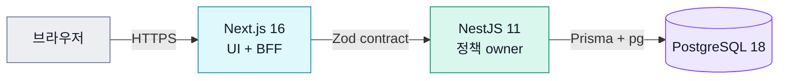
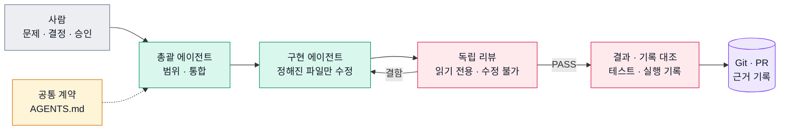

# KNU Roommate

강원대학교 재학생이 **생활패턴이 맞는 기숙사 룸메이트를 찾고, 대화와 매칭 신청으로 한 학기의 룸메이트를 정하도록 돕는 시즌 기반 웹 서비스**입니다.

> **현재 상태**: 출시 전 · 제품 코드, 자동 검증, 로컬 인프라 리허설 구현 완료 · 실제 사용자와 운영 환경 검증은 아직 하지 않음

[서비스 소개](./SERVICE.md) · [제품 정책](./docs/policies/README.md) · [아키텍처](./docs/architecture/README.md) · [개선 기록](./docs/evidence/README.md) · [AI 에이전트 하네스](#ai-에이전트-하네스) · [기여 안내](./CONTRIBUTING.md) · [운영 Runbook](./infra/runbooks/README.md)

## 한눈에 보기

기숙사 룸메이트는 한 학기 생활 만족도에 큰 영향을 주지만, 후보 찾기는 단체 채팅방·커뮤니티·지인 소개처럼 흩어진 채널에 기대기 쉽습니다. 수면·흡연·통화·청결 같은 생활 마찰 요소를 비교하기 어렵고, 재학생 여부·같은 기숙사 배정·지금 매칭할 수 있는지를 함께 확인하기도 어렵습니다.

**핵심 흐름**: 학교 이메일 인증 → 시즌 등록 → 생활패턴 기반 후보 탐색 → 대화와 매칭 → 시즌 이력 확인

가입과 시즌 참여는 같은 상태가 아닙니다. 현재 시즌, 필수 프로필, 기숙사 선택과 등록 트랜잭션이 끝나야 같은 기숙사 후보의 상세·매칭 기능이 열리고(미등록 사용자는 시즌 중 요약 미리보기만 봅니다), UI는 서버가 계산한 가능 여부(capability)와 사유를 그대로 보여 줍니다. 학교의 기숙사 배정이나 호실 선택은 대신하지 않습니다. 사용자, 핵심 개념, 시즌별 경험은 [서비스 소개](./SERVICE.md)에 있습니다.

## 이 저장소에서 볼 수 있는 것

| 관점               | 확인할 수 있는 것                                                                                            |
| ------------------ | ------------------------------------------------------------------------------------------------------------ |
| 정책 우선 설계     | 시즌·등록·공개 범위·매칭·채팅·보존 정책을 먼저 정하고 도메인 모델과 API contract로 연결                      |
| 풀스택 책임 경계   | Next.js UI·BFF, 공유 Zod contract, NestJS 정책 owner, Prisma·PostgreSQL 트랜잭션을 한 저장소에서 설계        |
| 동시성과 정합성    | 최종 경쟁 상태는 DB 제약과 트랜잭션이 판정, 동시 수락 교착은 잠금 순서로 제거([측정](#측정으로-확인한-개선)) |
| 안전한 변경        | 검증을 책임별 lane으로 나누고 바뀐 경로에 맞는 lane만 실행                                                   |
| 운영 준비          | 제한된 서버 자원, secret 전달, migration·rollback, 로그·지표·브라우저 오류 관측을 기능과 함께 설계           |
| AI 에이전트 하네스 | 정책 결정과 완료 판정은 사람과 독립 리뷰가 맡는 에이전트 workflow([하네스](#ai-에이전트-하네스))             |

## 아키텍처



- **Web**은 사용자 상호작용과 BFF 전달을 맡지만, 정책 판단을 복제하지 않습니다.
- **공유 contract**(`packages/shared`의 Zod)는 FE/BE 요청·응답과 enum을 런타임에 검증할 수 있는 타입으로 연결합니다.
- **API 도메인 owner**는 기능 가능 여부, 트랜잭션 전제 조건과 종료 사유를 계산합니다. 같은 DB schema를 써도 다른 도메인의 상태는 그 도메인이 연 service·port로만 바꿉니다([도메인 데이터 소유권](./docs/architecture/backend/domain-data-ownership.md)).
- **PostgreSQL**은 UNIQUE 제약과 트랜잭션으로 최종 경쟁 상태를 판정합니다.

배포 예정 구성(사용자 앱 host + private 관리형 PostgreSQL, 관측 스택 장애 격리)은 실제 배포를 마친 구성이 아니라 출시 전 계획과 로컬 리허설의 기준입니다. 구성도와 설명은 [운영 runtime 구성](./docs/architecture/platform/production-runtime-topology.md#출시-전-배포-구성도)에 있습니다.

## 대표 설계 결정

1. **화면 상태가 아니라 시즌 참여 aggregate를 기준으로 삼았습니다.** 탐색·상세·매칭·채팅은 화면별 boolean이 아니라 `SeasonParticipant`, 등록 확정 트랜잭션과 서버 capability로 판단합니다([시즌 참여 정책](./docs/policies/season-participation.md) · [룸메이트 탐색 정책](./docs/policies/roommate-searching.md) · [기능 가능 여부 설계](./docs/architecture/frontend/action-capability-source-of-truth.md)).
2. **사전 확인 API와 최종 트랜잭션의 책임을 나눴습니다.** 닉네임 확인 성공을 예약으로 보지 않고 회원가입 트랜잭션과 DB 제약이 최종 판정하며, 인증은 1회용 grant, Argon2id, DB에 저장하는 opaque session과 rotation·revoke 경계를 씁니다([계정 인증 정책](./docs/policies/account-authentication.md) · [opaque session 결정](./docs/architecture/backend/auth/jwt-vs-opaque-session-transport-decision.md)).
3. **서버 크기보다 자원 owner와 실패 경계를 먼저 정했습니다.** 2 vCPU / 4 GiB 사용자 앱 host에서 제품 container limit 합계를 2,976 MiB로 묶고, 관측 스택이 멈춰도 사용자 요청은 막히지 않게 했습니다. 실제 운영 성능 주장이 아니라 출시 전 리허설 기준입니다([운영 runtime 구성](./docs/architecture/platform/production-runtime-topology.md) · [풀스택 리허설 자원 예산](./infra/runbooks/rehearsal/full-stack.md) · [출시 준비 상태](./infra/runbooks/release/components/infrastructure-target/readiness.md)).

## 측정으로 확인한 개선

모든 수치는 공개 commit·PR·재현 명령으로 다시 산출할 수 있고, 측정 조건은 각 기록에 있습니다([개선 기록](./docs/evidence/README.md)).

| 개선                     | 결과                                                                                                                                                                                                             | 기록                                                                                         |
| ------------------------ | ---------------------------------------------------------------------------------------------------------------------------------------------------------------------------------------------------------------- | -------------------------------------------------------------------------------------------- |
| 동시 매칭 수락 교착 제거 | 두 수락의 경합 통합 테스트 2개 × 10회에서 교착 **20/20 → 0/20**, 진 쪽 `P2010`(오류 매핑상 500) → **409** `MATCH_REQUEST_NOT_PENDING`                                                                            | [잠금 순서 기록](./docs/evidence/matches/accept-lock-order-evidence.md)                      |
| Monorepo CI 재구성       | Infra·정책 PR wall 중앙값 **79s**(n=5), 전체 lane PR wall 중앙값 616s(n=5) → 최종 source run 1건 **330s**(이후 자연 표본 8개 중앙값 381s). 대신 job별 분 올림 합은 28분 → 31분(자연 표본 중앙값 34분)으로 늘어남 | [CI 재구성 기록](./docs/evidence/ci/monorepo-ci-restructuring-evidence.md)                   |
| 에이전트 workflow 개선   | 공통 계약 + host adapter로 분리, 개선 PR 28개의 리뷰 결함·merge 뒤 결함을 공개 근거로 재산출. 시간 절감은 비교군이 없어 주장하지 않음                                                                            | [workflow 개선 기록](./docs/evidence/agent-workflows/agent-workflow-improvement-evidence.md) |

## AI 에이전트 하네스

1인 개발에서 AI 에이전트(Codex, Claude Code)를 분석·구현·검증 보조로 씁니다. 하네스의 목적은 **에이전트의 완료 보고를 그대로 믿지 않고, 실행 기록과 독립 리뷰로 확인하는 것**입니다. 코드를 많이 만드는 것보다, 혼자 개발할 때 놓치기 쉬운 정책 충돌과 변경 영향을 반복해서 드러내고 검증할 수 있는 근거로 결정하는 데 씁니다.



- **같은 지침에서 시작**: 모든 에이전트는 공통 저장소 계약 [`AGENTS.md`](./AGENTS.md)에서 시작하고, host별 실행 세부만 [host adapter](./docs/development/agent-workflows/adapters/README.md)가 연결합니다.
- **역할별 권한 분리**: 구현 에이전트는 등록된 파일 범위만 고치고, 리뷰어는 읽기 전용 도구만 가집니다. 완료 판정은 코드를 고칠 수 없는 리뷰어와 실제 검증 출력이 맡습니다.
- **기계적으로 막을 수 있는 것은 hook과 CI로**: 등록과 다른 위임 요청이나 구현 에이전트 실행 중 총괄 에이전트의 추적 파일 쓰기처럼 규칙으로 판정할 수 있는 위반은 hook과 저장소 정책 테스트가 막고, 의미·경계 문제는 리뷰가 판단합니다.
- **기준을 가진 리뷰**: 리뷰어는 바뀐 경로로 고른 [변경 유형별 리뷰 기준](./docs/development/agent-workflows/review-criteria/README.md)으로 판정하고, `critical`·`high`·`medium` finding이 남으면 통과하지 못합니다. 같은 변경이 3회 연속 통과하지 못하면 무인으로 계속하지 않고 사람에게 다음 행동을 묻습니다([리뷰 회차](./docs/development/agent-workflows/qa.md#리뷰-회차)).
- **사람이 결정하는 것**: 제품·비용·위험 선택은 사람이, 승인된 범위의 기술 판단과 결과 통합은 총괄 에이전트가 맡습니다([협업 계약](./docs/development/agent-workflows/owner-lead-collaboration.md)). 검증하지 못한 범위는 완료로 포장하지 않고 blocker와 다음 근거로 남깁니다.

| 책임      | 사람이 맡는 것                                                  | AI 에이전트가 돕는 것                            |
| --------- | --------------------------------------------------------------- | ------------------------------------------------ |
| 문제·정책 | 사용자 문제 정의, 허용 범위, 보안·개인정보 trade-off, 최종 결정 | 관련 코드 탐색, 충돌과 누락 질문 도출, 대안 비교 |
| 설계      | 도메인 owner, contract와 트랜잭션 경계, 채택·기각 판단          | 구조 초안, 영향 범위 정리, 공식 자료 조사        |
| 구현      | 변경 범위 승인, 핵심 diff 검토, 완료 여부 판정                  | 반복 구현, fixture·테스트 보강, 호출부 이동      |
| 품질      | 인수 기준과 검증 수준 결정                                      | 정적 검사, 회귀 테스트, 실패 원인 탐색           |
| 운영      | 비용·위험 수용, 배포·rollback 책임 결정                         | 리허설 harness, 근거 template, 낡은 문서 탐색    |

더 보려면:

- [Agentic Engineering 방법론](./docs/evidence/agent-workflows/agentic-engineering-methodology.md): 선택한 개발 방식, 적용 수준과 한계
- [Agent workflow 개선 기록](./docs/evidence/agent-workflows/agent-workflow-improvement-evidence.md): 개선 PR 28개의 리뷰 기록·계약 test 수·merge 뒤 결함
- [리뷰 기준 교정 기록](./docs/evidence/agent-workflows/review-criteria-calibration.md): 영역 리뷰 기준을 준 reviewer와 기준 없는 reviewer의 결함 재발견률·오탐·비용 비교
- [Parent–subagent 설계 사례](./docs/evidence/agent-workflows/agentic-orchestration-case-study.md): 문제·대안·구현·검증·한계
- [Agent workflow guides](./docs/development/agent-workflows/README.md): 에이전트가 읽는 실행 규칙의 목록

AI가 실제 팀 협업이나 운영 경험을 대신한다고 보지 않습니다. 실사용자 피드백, 실제 장애 대응, 운영 부하 근거는 아직 없으며 이 README는 이를 구현·리허설 결과와 구분합니다.

## 검증 체계

테스트 파일 수보다 **어떤 위험을 어느 검증 계층이 맡는지**를 기준으로 저장소 정책, Shared contract, API unit·integration·E2E·부하 harness, Web component·BFF, Playwright, Storybook, 인프라 리허설을 나눴습니다. Monorepo CI는 바뀐 경로를 Shared·API·Web·Infra·저장소 정책으로 분류해 필요한 lane만 실행하고, 선택된 lane 중 하나라도 실패하면 하나의 요약 gate에서 막습니다. 설계와 측정 기준은 [Monorepo CI 아키텍처](./docs/architecture/platform/monorepo-ci.md)에 있습니다.

## 운영과 관측

관측은 배포 뒤 **사용자가 겪은 실패를 재현하고 변경의 영향을 판단하기 위한 제품 경계**로 설계했습니다. API·BFF 구조화 로그는 Loki, 런타임·도메인 지표는 Prometheus, 브라우저 오류·성능은 Sentry, 관리형 DB 자원은 CloudWatch로 나누고, 수집기 장애가 제품 요청을 막지 않게 합니다. 로그와 지표는 매칭 성공률 같은 제품 분석을 대신하지 않습니다. 도구 책임은 [관측 구성](./docs/architecture/platform/observability-topology.md), 개인정보·보존·접근 범위는 [운영 관측 정책](./docs/policies/operational-observability.md)이 정합니다.

## 기술 스택

| 영역      | 현재 기준                                                           | 선택 목적                                      |
| --------- | ------------------------------------------------------------------- | ---------------------------------------------- |
| Runtime   | Node.js 24, pnpm 11                                                 | workspace와 CI runtime 일치                    |
| 언어      | TypeScript 6                                                        | FE·BE·shared contract의 정적 경계              |
| Web       | Next.js 16, React 19, Tailwind CSS 4                                | App Router, BFF, 반응형 제품 UI                |
| API       | NestJS 11, Joi, Pino                                                | DI 기반 도메인 owner, 런타임 설정, 구조화 로그 |
| Contract  | Zod 4 (`packages/shared`)                                           | 요청·응답 런타임 검증과 타입 공유              |
| 저장소    | PostgreSQL 18, Prisma 7, `pg`                                       | 관계·제약·트랜잭션과 타입 있는 query           |
| 보안      | Argon2id, HMAC·envelope 암호화, opaque session                      | 자격 증명과 session lifecycle 보호             |
| 검증      | Vitest 5, Testing Library, Supertest, Playwright 1.63, Storybook 10 | unit부터 브라우저·화면까지 계층 분리           |
| 관측      | Prometheus, Loki, Alloy, Grafana, Alertmanager, Sentry              | 지표·로그·브라우저 신호의 책임 분리            |
| 전달      | Docker Compose, GitHub Actions                                      | 재현 가능한 로컬 리허설과 선택 실행 CI         |
| 출시 대상 | AWS Lightsail, RDS PostgreSQL, Secrets Manager                      | 실제 계정 근거가 필요한 출시 전 결정           |

버전의 기준은 [`package.json`](./package.json), [`pnpm-workspace.yaml`](./pnpm-workspace.yaml)의 catalog, 각 app package와 고정된 container image입니다.

## 시작하기

### 필요 환경

Node.js `>=24 <25` · pnpm `11.24.0` · Docker · Docker Compose

### 로컬 실행

```bash
pnpm install
cp apps/web/.env.example apps/web/.env
pnpm db:up                           # 로컬 PostgreSQL 18 (127.0.0.1:5432)
pnpm --dir apps/api prisma:migrate
pnpm db:seed
pnpm dev
```

Web은 `http://localhost:3000`, API는 `http://localhost:4000`에서 열립니다.

- API는 개발 환경에서 `docker-compose.dev.yml`의 로컬 DB에 맞춘 기본값으로 실행되므로, 따로 설정할 필요가 없습니다. 접속 정보를 바꿀 때만 `apps/api/.env`에 `DATABASE_URL`·`DIRECT_URL`을 적고, 보존(retention) 암호화 키가 필요한 흐름을 로컬에서 시험할 때만 해당 키를 추가로 설정합니다.
- `.env.example`은 개발용 입력 형식만 제공합니다. 운영 secret은 image나 Git에 넣지 않고 출시 runtime에서 주입하며, 불변 조건은 [운영 runtime 안전 정책](./docs/policies/production-runtime-safety.md)을 따릅니다.

### 검증

```bash
pnpm check:fast          # staged 파일과 작업 공간 배치
pnpm test:repo-policy    # 저장소 경계
pnpm shared:test         # Shared contract
pnpm api:check           # API 정적 검사
pnpm web:check           # Web 정적 검사
pnpm infra:check         # 인프라 검사
```

API·Web 테스트와 CI lane별 명령은 [Monorepo CI 아키텍처의 명령 표](./docs/architecture/platform/monorepo-ci.md#public-command와-prepared-command)와 [API README](./apps/api/README.md) · [Web README](./apps/web/README.md)에 있습니다. 전체 부하 테스트와 풀스택 리허설은 일반 PR gate보다 무거워서 명시적인 리허설에서 실행합니다([인프라 리허설 runbook](./infra/runbooks/rehearsal/full-stack.md)).

## 저장소 구조

```text
knu_roommate/
├── apps/
│   ├── web/                 # Next.js UI, BFF, Storybook, Playwright
│   └── api/                 # NestJS 도메인, Prisma, API 테스트
├── packages/
│   ├── shared/              # FE·BE Zod contract와 도메인 상수
│   ├── eslint-config/       # 공통 lint 정책
│   └── tsconfig/            # 공통 TypeScript 설정
├── docs/
│   ├── policies/            # 제품·운영 불변 조건
│   ├── architecture/        # 장기 기술 결정과 책임 경계
│   ├── evidence/            # 개선의 측정값·설계 근거·문제 해결 기록
│   ├── runbooks/            # 제품 도메인 반복 운영 절차
│   └── development/         # 개발·CI 기준, 에이전트 workflow, troubleshooting
├── infra/                   # 배포, 리허설, 관측과 출시 준비
├── scripts/                 # CI, 검증, 리허설, 에이전트 workflow 실행기
├── .claude/ · .codex/       # host별 에이전트 역할 정의
├── AGENTS.md                # 모든 coding agent의 공통 저장소 계약
├── SERVICE.md               # 사용자 관점의 제품 설명
└── README.md
```

## 현재 상태와 한계

| 항목                           | 상태           | 의미                                                                                   |
| ------------------------------ | -------------- | -------------------------------------------------------------------------------------- |
| 제품 기능·contract·DB baseline | 구현됨         | 저장소 코드와 자동 테스트로 검증 가능                                                  |
| Monorepo CI와 로컬 검증        | 구현됨         | 바뀐 경로별 검증 명령과 workflow 존재                                                  |
| 풀스택 로컬 리허설             | 리허설 가능    | 제한된 Docker 자원에서 재현할 수 있는 harness와 runbook                                |
| 운영 provider·DNS·TLS·RDS      | 출시 근거 대기 | 실제 provider에서 DNS·TLS, private DB, 백업·복원, rollback과 관측 내구성을 검증해야 함 |
| 실사용자 UX·운영 지표          | 아직 없음      | 실제 사용자 데이터와 운영 장애 경험이 없음. 출시와 사용자 검증 이후 측정               |
| BackOffice                     | 설계 결정만    | 별도 host·배포·권한 경계만 정했고 제품은 미구현                                        |

- 강원대학교 공식 서비스가 아니며, 학교의 기숙사 배정·호실 선택 결과를 보장하지 않습니다.
- 사용자 행동 분석과 매칭 품질 평가는 운영 로그가 아니라, 목적·동의·schema를 따로 갖춘 제품 분석으로 설계해야 합니다.

## 문서 안내

| 문서                                         | 내용                                                              |
| -------------------------------------------- | ----------------------------------------------------------------- |
| [서비스 소개](./SERVICE.md)                  | 사용자 문제, 제품 범위와 핵심 흐름                                |
| [제품 정책](./docs/policies/README.md)       | 인증, 시즌, 프로필, 매칭, 채팅, 안전, 보존 정책의 source of truth |
| [아키텍처](./docs/architecture/README.md)    | FE·BE·데이터·플랫폼의 장기 결정과 근거                            |
| [개선 기록](./docs/evidence/README.md)       | 개선의 측정값, 원인, 대안과 전후 비교                             |
| [제품 Runbook](./docs/runbooks/README.md)    | 시즌 운영과 제품 도메인 절차                                      |
| [인프라 Runbook](./infra/runbooks/README.md) | 리허설, 장애 대응, 출시 준비와 근거                               |
| [개발 가이드](./docs/development/README.md)  | CI 기준, 에이전트 workflow와 재사용 가능한 troubleshooting        |
| [기여 안내](./CONTRIBUTING.md)               | 개발 환경, 변경 경계와 AI 보조 workflow 진입점                    |
