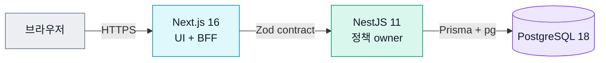
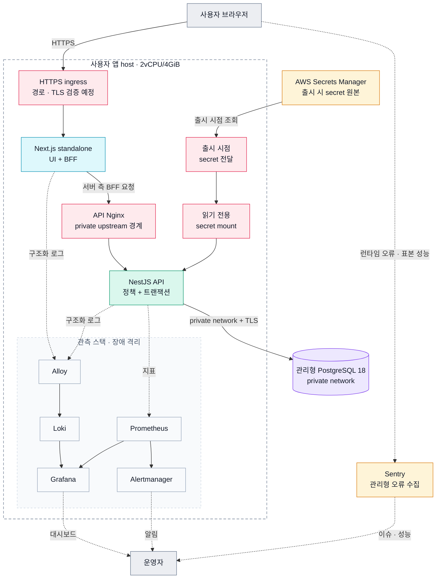
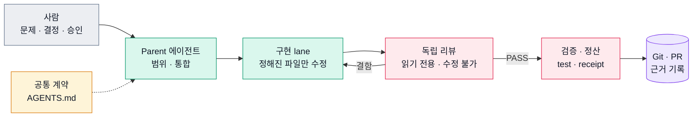

# KNU Roommate

강원대학교 재학생이 **생활패턴이 맞는 기숙사 룸메이트를 찾고, 대화와 매칭 신청으로 한 학기의 룸메이트를 정하도록 돕는 시즌 기반 웹 서비스**입니다.

> **현재 상태**: 출시 전 · 제품 코드, 자동 검증, 로컬 인프라 리허설 구현 완료 · 실제 사용자와 운영 환경 검증은 아직 하지 않음

[서비스 소개](./SERVICE.md) · [제품 정책](./docs/policies/README.md) · [아키텍처](./docs/architecture/README.md) · [개선 기록](./docs/evidence/README.md) · [기여 안내](./CONTRIBUTING.md) · [운영 Runbook](./infra/runbooks/README.md)

## 목차

1. [해결하려는 문제](#해결하려는-문제)
2. [이 저장소에서 볼 수 있는 것](#이-저장소에서-볼-수-있는-것)
3. [사용자 흐름](#사용자-흐름)
4. [아키텍처 한눈에 보기](#아키텍처-한눈에-보기)
5. [대표 설계 결정](#대표-설계-결정)
6. [측정으로 확인한 개선](#측정으로-확인한-개선)
7. [AI 에이전트 개발 방식](#ai-에이전트-개발-방식)
8. [검증 체계](#검증-체계)
9. [운영과 관측](#운영과-관측)
10. [현재 상태](#현재-상태)
11. [기술 스택](#기술-스택)
12. [저장소 구조](#저장소-구조)
13. [시작하기](#시작하기)
14. [문서 안내](#문서-안내)
15. [현재 한계](#현재-한계)

## 해결하려는 문제

기숙사 룸메이트는 한 학기 생활 만족도에 큰 영향을 주지만, 후보를 찾는 과정은 단체 채팅방·커뮤니티·지인 소개처럼 흩어진 채널에 기대기 쉽습니다.

- 수면, 흡연, 통화, 청결, 실내 취식처럼 생활 마찰 요소를 구조적으로 비교하기 어렵습니다.
- 재학생 여부, 같은 기숙사 배정, 지금 매칭할 수 있는지를 함께 확인하기 어렵습니다.
- 대화·신청·수락·매칭 해제·과거 이력이 서로 다른 채널에 흩어집니다.
- 신고, 차단, 탈퇴 후 비식별화처럼 운영에 필요한 안전 장치가 약합니다.

KNU Roommate는 이를 **학교 이메일 인증 → 시즌 등록 → 생활패턴 기반 후보 탐색 → 대화와 매칭 → 시즌 이력 확인**이라는 하나의 흐름으로 잇습니다. 학교의 기숙사 배정이나 호실 선택을 대신하지 않고, 그 전에 필요한 룸메이트 탐색과 합의를 돕는 것이 제품의 범위입니다.

## 이 저장소에서 볼 수 있는 것

| 관점             | 확인할 수 있는 것                                                                                                                 |
| ---------------- | --------------------------------------------------------------------------------------------------------------------------------- |
| 정책 우선 설계   | 화면보다 먼저 시즌·등록·공개 범위·매칭·채팅·보존 정책을 정하고, 이를 도메인 모델과 API contract로 연결했습니다.                   |
| 풀스택 책임 경계 | Next.js UI·BFF, 공유 Zod contract, NestJS 정책 owner, Prisma·PostgreSQL 트랜잭션을 한 저장소에서 일관된 경계로 설계했습니다.      |
| 동시성과 정합성  | 최종 경쟁 상태는 DB 제약과 트랜잭션이 판정하고, 동시 수락 교착은 잠금 순서를 고쳐 없앴습니다([측정 기록](#측정으로-확인한-개선)). |
| 안전한 변경      | lint·typecheck·unit·integration·E2E·부하 harness·저장소 정책 테스트를 책임별 lane으로 나누고, 바뀐 경로에 맞는 lane만 실행합니다. |
| 운영 준비        | 제한된 서버 자원, secret 전달, migration, rollback, 로그·지표·브라우저 오류 관측을 기능 개발과 함께 설계했습니다.                 |
| AI 에이전트 활용 | 에이전트를 구현 보조로 쓰되, 정책 결정·trade-off 선택·완료 판정은 사람과 독립 리뷰가 맡도록 workflow를 만들었습니다.              |

## 사용자 흐름

1. 학교 이메일 인증
2. 계정과 학적 정보 생성
3. 현재 시즌 확인
4. 기숙사·생활패턴 입력과 시즌 등록
5. 같은 조건의 후보 탐색
6. 프로필 비교와 대화
7. 매칭 신청·수락
8. 현재 매칭 관리와 시즌 이력 확인

가입과 시즌 참여는 같은 상태가 아닙니다. 계정이 있어도 현재 시즌, 필수 프로필, 기숙사 선택과 등록 트랜잭션이 끝나야 탐색·상세·매칭 기능이 열립니다. UI는 이 조건을 스스로 추측하지 않고, 서버가 계산한 가능 여부(capability)와 사유를 그대로 보여 줍니다.

## 아키텍처 한눈에 보기

다이어그램 색은 역할을 뜻합니다: <b>청록</b> 사용자 화면 · <b>초록</b> 서버 애플리케이션 · <b>보라</b> 데이터베이스 · <b>주황</b> 관리형 클라우드 · <b>장미색</b> 보안·경계 · <b>회색</b> 사용자·운영 도구.

### 애플리케이션 흐름



사용자 화면과 BFF는 Web이, 정책과 트랜잭션의 최종 판단은 API와 PostgreSQL이 맡습니다. `packages/shared`의 Zod contract가 이 경계를 런타임에 검증할 수 있는 타입으로 연결합니다.

### 배포 예정 구성

아래 그림은 **실제 배포를 마친 구성이 아니라, 출시 전 계획과 로컬 리허설의 기준**입니다. 공개 ingress의 TLS 종료·경로, provider 식별자와 네트워크는 실제 운영 환경에서 검증한 뒤 출시 근거로 확정합니다.



- 브라우저의 일반 UI·BFF 요청은 Next.js로 들어가고, BFF가 private API Nginx를 거쳐 NestJS를 호출합니다.
- API는 private 관리형 PostgreSQL에 연결하며, DB는 사용자 앱 host의 4 GiB 자원 예산에 넣지 않습니다.
- 운영 secret은 image나 Git에 넣지 않고, 출시 시점에 받아 읽기 전용 파일로 API container에 제공합니다.
- 로그·지표·브라우저 신호는 각각 Loki·Prometheus·Sentry로 나누고, 관측 장애가 제품 요청을 막지 않게 합니다.

### 경계 원칙

- **Web**은 사용자 상호작용과 BFF 전달을 맡지만, 정책 판단을 복제하지 않습니다.
- **공유 contract**는 FE/BE 요청·응답과 enum을 런타임에 검증할 수 있는 타입으로 연결합니다.
- **API 도메인 owner**는 기능 가능 여부, 트랜잭션 전제 조건과 종료 사유를 계산합니다.
- **도메인 데이터 소유권**: 같은 DB schema를 써도 쓰기 권한은 공유하지 않습니다. 다른 도메인의 상태는 그 도메인이 연 service·port로만 바꿉니다([도메인 데이터 소유권](./docs/architecture/backend/domain-data-ownership.md)).
- **PostgreSQL**은 UNIQUE 제약과 트랜잭션으로 최종 경쟁 상태를 판정합니다.
- **관측 데이터**는 장애·성능 분석에만 쓰고, 매칭 성공률 같은 제품 분석 데이터와 분리합니다.

## 대표 설계 결정

### 1. 화면 상태가 아니라 시즌 참여 aggregate를 기준으로 삼았습니다

초기 prototype에서는 `User`와 화면별 boolean이 가입, 시즌 준비, 공개 여부, 매칭 가능 여부를 함께 표현했습니다. 그래서 작은 정책 변경도 화면과 API마다 다르게 해석되는 문제가 생겼습니다.

이를 다음 책임으로 나눴습니다.

| 모델                                           | 책임                                                           |
| ---------------------------------------------- | -------------------------------------------------------------- |
| `User`                                         | 로그인할 수 있는 계정                                          |
| `UserDisplayIdentity` · `UserAcademicIdentity` | 표시용 identity와 학적 identity                                |
| `SeasonParticipant`                            | 특정 시즌 참여의 기준점                                        |
| 시즌 프로필·기숙사 선택                        | 등록 전 초안                                                   |
| 등록 확정(registration finalize)               | 공개 가능한 참여 상태와 이력 snapshot을 함께 확정하는 트랜잭션 |

탐색·상세·매칭·채팅은 `SeasonParticipant`와 서버 capability를 기준으로 판단합니다. 근거는 [시즌 참여 정책](./docs/policies/season-participation.md), [룸메이트 탐색 정책](./docs/policies/roommate-searching.md), [기능 가능 여부 설계](./docs/architecture/frontend/action-capability-source-of-truth.md)에 있습니다.

### 2. 사전 확인 API와 최종 트랜잭션의 책임을 나눴습니다

회원가입 닉네임 확인은 빠른 피드백을 주지만, 확인 직후 다른 사용자가 같은 값을 먼저 쓸 수 있습니다. 그래서 사전 확인 성공을 예약으로 보지 않습니다.

- 닉네임 확인 API는 형식·금칙어·현재 중복 상태를 안내합니다.
- 실제 회원가입 트랜잭션이 같은 정책을 다시 검증합니다.
- 최종 중복 여부는 DB 제약이 판정합니다.
- 경쟁이 생기면 UI는 닉네임 입력 단계로 돌아가 다시 확인하도록 안내합니다.

인증도 같은 원칙을 따릅니다. 목적과 사용자에 묶인 1회용 grant, Argon2id 비밀번호, DB에 저장하는 opaque access·renewal session과 rotation·revoke 경계를 씁니다. 근거는 [계정 인증 정책](./docs/policies/account-authentication.md)과 [opaque session 결정](./docs/architecture/backend/auth/jwt-vs-opaque-session-transport-decision.md)에 있습니다.

### 3. 서버 크기보다 자원 owner와 실패 경계를 먼저 정했습니다

출시 전 계획·리허설 기준은 **2 vCPU / 4 GiB 사용자 앱 host + private 관리형 PostgreSQL 18**입니다. 사용자 host에는 nginx, Web, API와 관측 스택을 두고, 제품 container limit 합계를 2,976 MiB로 묶어 OS·Docker·파일시스템 캐시와 순간 부하에 약 1.1 GiB를 남깁니다.

- 초기 사용자 규모에 맞춰 비용과 운영 복잡도를 줄입니다.
- Argon2id와 제품 트랜잭션이 관측 도구보다 먼저 자원을 쓰도록 합니다.
- Loki, Prometheus, Grafana가 멈춰도 사용자 요청은 막히지 않게 합니다.
- 미래의 BackOffice는 8 GiB 단일 host로 합치지 않고 별도 2 GiB host로 나눠, 운영자 ingress·배포·장애 범위를 격리합니다.

이 수치는 실제 운영 성능 주장이 아닙니다. 지금은 2 CPU / 4 GiB 제품 envelope와 외부 DB를 흉내 내는 일회용 PostgreSQL로 연결·migration·자원·관측 장애 격리를 리허설합니다. 실제 provider, region, 네트워크, RDS 지연과 가격은 출시 시점에 다시 확인합니다. 근거는 [운영 runtime 구성](./docs/architecture/platform/production-runtime-topology.md), [풀스택 리허설 자원 예산](./infra/runbooks/rehearsal/full-stack.md), [출시 준비 상태](./infra/runbooks/release/components/infrastructure-target/readiness.md)에 있습니다.

## 측정으로 확인한 개선

모든 수치는 공개 commit·PR·재현 명령으로 다시 산출할 수 있고, 측정 조건을 함께 적었습니다. 상세 기록은 [개선 기록](./docs/evidence/README.md)에 있습니다.

| 개선                     | 문제                                                                                    | 결과 (측정 조건)                                                                                                                                                                                                           | 기록                                                                                         |
| ------------------------ | --------------------------------------------------------------------------------------- | -------------------------------------------------------------------------------------------------------------------------------------------------------------------------------------------------------------------------- | -------------------------------------------------------------------------------------------- |
| 동시 매칭 수락 교착 제거 | 같은 참가자가 걸린 두 수락이 잠금을 서로 반대 순서로 잡아 교착, 진 쪽은 오류 매핑상 500 | 교착 **20/20 → 0/20**, 진 쪽 `P2010`(매핑상 500) → **409** `MATCH_REQUEST_NOT_PENDING`, 테스트 시간 중앙값 1,341ms → 278ms (경합 통합 테스트 2개 × 10회, 로컬 장비 한 대·PostgreSQL 18, 두 수락의 경합만 측정, 2026-10-08) | [잠금 순서 기록](./docs/evidence/matches/accept-lock-order-evidence.md)                      |
| Monorepo CI 재구성       | 어떤 변경이든 API·Web lane을 모두 실행, 준비 작업 반복                                  | Infra·정책 PR wall 중앙값 **79s** (n=5). 전체 lane PR wall 중앙값 616s (n=5) → 최종 source run 1건 **330s**, 이후 자연 표본 8개 중앙값 381s. 대신 job별 분 올림 합은 28분 → 31분(자연 표본 중앙값 34분)으로 늘었음         | [CI 재구성 기록](./docs/evidence/ci/monorepo-ci-restructuring-evidence.md)                   |
| 에이전트 workflow 개선   | 단일 host 전제, 리뷰 결과가 PR 본문에만 흩어짐                                          | 공통 계약 + host adapter로 분리, 개선 PR 28개의 리뷰 결함·merge 뒤 결함을 공개 근거로 재산출 (시간 절감은 비교군이 없어 주장하지 않음)                                                                                     | [workflow 개선 기록](./docs/evidence/agent-workflows/agent-workflow-improvement-evidence.md) |

## AI 에이전트 개발 방식

1인 개발에서 AI 에이전트(Codex, Claude Code)를 분석·구현·검증 보조로 씁니다. 목표는 코드를 많이 만드는 것이 아니라, 혼자 개발할 때 놓치기 쉬운 정책 충돌과 변경 영향을 반복해서 드러내고 **검증할 수 있는 근거로 결정하는 체계**를 만드는 것입니다.



- **같은 지침에서 시작**: 모든 에이전트는 공통 저장소 계약 [`AGENTS.md`](./AGENTS.md)에서 시작하고, host별 실행 세부만 [host adapter](./docs/development/agent-workflows/adapters/README.md)가 연결합니다.
- **역할별 권한 분리**: 구현자는 등록된 파일 범위만 고치고, 리뷰어는 읽기 전용 도구만 가집니다. 완료 판정은 코드를 고칠 수 없는 리뷰어와 실제 검증 출력이 맡습니다.
- **기계적으로 막을 수 있는 것은 hook과 CI로**: 등록과 다른 위임 요청이나 구현 lane 실행 중 Parent의 추적 파일 쓰기처럼 결정적인 위반은 hook과 저장소 정책 테스트가 막고, 의미·경계 문제는 리뷰가 판단합니다.
- **사람이 결정하는 것**: 제품·비용·위험 선택은 사람이, 승인된 범위의 기술 판단과 결과 통합은 Parent 에이전트가 맡습니다([협업 계약](./docs/development/agent-workflows/owner-lead-collaboration.md)).
- **실패를 완료로 포장하지 않음**: 검증하지 못한 범위는 blocker와 다음 근거로 남기고, 장기 기록은 임시 분석이 아니라 코드·테스트·정책·아키텍처·runbook·Git 기록에 둡니다.

| 책임      | 사람이 맡는 것                                                  | AI 에이전트가 돕는 것                            |
| --------- | --------------------------------------------------------------- | ------------------------------------------------ |
| 문제·정책 | 사용자 문제 정의, 허용 범위, 보안·개인정보 trade-off, 최종 결정 | 관련 코드 탐색, 충돌과 누락 질문 도출, 대안 비교 |
| 설계      | 도메인 owner, contract와 트랜잭션 경계, 채택·기각 판단          | 구조 초안, 영향 범위 정리, 공식 자료 조사        |
| 구현      | 변경 범위 승인, 핵심 diff 검토, 완료 여부 판정                  | 반복 구현, fixture·테스트 보강, 호출부 이동      |
| 품질      | 인수 기준과 검증 수준 결정                                      | 정적 검사, 회귀 테스트, 실패 원인 탐색           |
| 운영      | 비용·위험 수용, 배포·rollback 책임 결정                         | 리허설 harness, 근거 template, 낡은 문서 탐색    |

AI가 실제 팀 협업이나 운영 경험을 대신한다고 보지 않습니다. 실사용자 피드백, 실제 장애 대응, 운영 부하 근거는 아직 없으며 이 README는 이를 구현·리허설 결과와 구분합니다. 방법론의 선택 이유와 적용 수준은 [Agentic Engineering 방법론](./docs/evidence/agent-workflows/agentic-engineering-methodology.md)에 정리했습니다.

## 검증 체계

테스트 파일 수보다 **어떤 위험을 어느 검증 계층이 맡는지**를 기준으로 구성했습니다.

| 검증 계층           | 주요 책임                                                                |
| ------------------- | ------------------------------------------------------------------------ |
| 저장소 정책         | source of truth 경계, 금지 경로, workflow·artifact·문서 책임의 회귀 차단 |
| Shared              | Zod contract와 도메인 상수의 타입·런타임 정합성                          |
| API unit            | 정책, command, query, presenter와 실패 매핑                              |
| API integration·E2E | PostgreSQL 제약·트랜잭션, HTTP contract, 인증·session과 도메인 lifecycle |
| API 부하 harness    | Argon2id, DB pool, admission과 Docker 기반 부하 시나리오의 실행 가능성   |
| Web component·BFF   | UI 상태, 접근성, 입력 복구, BFF 허용 목록과 오류 매핑                    |
| Playwright          | 데스크톱·모바일 브라우저 smoke와 주요 사용자 경로                        |
| Storybook           | 정책 상태별 PC·모바일 UI를 API 없이 비교하는 화면 작업대                 |
| 인프라 리허설       | 새 DB migration, Web→API, 지표·로그 수집, 관측 장애 격리와 정리          |

Monorepo CI는 바뀐 경로를 Shared·API·Web·Infra·저장소 정책으로 분류합니다. Web만 바꾼 PR에 PostgreSQL lane을, API만 바꾼 PR에 브라우저 lane을 돌리지 않으며, 선택된 lane 결과는 하나의 요약 gate에서 하나라도 실패하면 막히도록 판정합니다. 설계와 측정 기준은 [Monorepo CI 아키텍처](./docs/architecture/platform/monorepo-ci.md)에 있습니다.

## 운영과 관측

관측은 포트폴리오용 부가 기능이 아니라, 배포 뒤 **사용자가 겪은 실패를 재현하고 변경의 영향을 판단하기 위한 제품 경계**로 설계했습니다.

| 신호                | 수집·저장                                                   | 확인 목적                             |
| ------------------- | ----------------------------------------------------------- | ------------------------------------- |
| API·BFF 구조화 로그 | Pino·Web logger → Alloy → Loki → Grafana                    | 요청 실패와 서버 측 원인 탐색         |
| 런타임·도메인 지표  | `@prometheus-io/client` → Prometheus → Grafana·Alertmanager | 지연, 포화, 실패 추세와 알림          |
| 브라우저 오류·성능  | Sentry Next.js SDK → 관리형 Sentry                          | 사용자 브라우저 오류와 Web Vital 회귀 |
| 관리형 DB 자원      | CloudWatch·DB Insights                                      | 연결, CPU, 메모리, I/O 상태           |

관측 port는 인터넷에 직접 노출하지 않고, 수집기 장애가 제품 요청을 막지 않아야 합니다. 로그와 지표는 사용자 행동 분석을 대신하지 않으며, 개인정보·보존·접근 범위는 [운영 관측 정책](./docs/policies/operational-observability.md), 도구 책임은 [관측 구성](./docs/architecture/platform/observability-topology.md)이 정합니다.

## 현재 상태

| 항목                           | 상태           | 의미                                                    |
| ------------------------------ | -------------- | ------------------------------------------------------- |
| 제품 기능·contract·DB baseline | 구현됨         | 저장소 코드와 자동 테스트로 검증 가능                   |
| Monorepo CI와 로컬 검증        | 구현됨         | 바뀐 경로별 검증 명령과 workflow 존재                   |
| 풀스택 로컬 리허설             | 리허설 가능    | 제한된 Docker 자원에서 재현할 수 있는 harness와 runbook |
| 운영 provider·DNS·TLS·RDS      | 출시 근거 대기 | 실제 계정·대상에서 아직 검증하지 않음                   |
| 실사용자 UX·운영 지표          | 아직 없음      | 출시와 사용자 검증 이후 측정                            |
| BackOffice                     | 설계 결정만    | 별도 host·배포·권한 경계만 정했고 제품은 미구현         |

## 기술 스택

| 영역      | 현재 기준                                                           | 선택 목적                                      |
| --------- | ------------------------------------------------------------------- | ---------------------------------------------- |
| Runtime   | Node.js 24, pnpm 11                                                 | workspace와 CI runtime 일치                    |
| 언어      | TypeScript 6                                                        | FE·BE·shared contract의 정적 경계              |
| Web       | Next.js 16, React 19, Tailwind CSS 4                                | App Router, BFF, 반응형 제품 UI                |
| API       | NestJS 11, Joi, Pino                                                | DI 기반 도메인 owner, 런타임 설정, 구조화 로그 |
| Contract  | Zod 4 (`packages/shared`)                                           | 요청·응답 런타임 검증과 타입 공유              |
| 저장소    | PostgreSQL 18, Prisma 7, `pg`                                       | 관계·제약·트랜잭션과 타입 있는 query           |
| 보안      | Argon2id, HMAC·envelope 암호화, opaque session                      | 자격 증명과 session lifecycle 보호             |
| 검증      | Vitest 5, Testing Library, Supertest, Playwright 1.63, Storybook 10 | unit부터 브라우저·화면까지 계층 분리           |
| 관측      | Prometheus, Loki, Alloy, Grafana, Alertmanager, Sentry              | 지표·로그·브라우저 신호의 책임 분리            |
| 전달      | Docker Compose, GitHub Actions                                      | 재현 가능한 로컬 리허설과 선택 실행 CI         |
| 출시 대상 | AWS Lightsail, RDS PostgreSQL, Secrets Manager                      | 실제 계정 근거가 필요한 출시 전 결정           |

버전의 기준은 [`package.json`](./package.json), [`pnpm-workspace.yaml`](./pnpm-workspace.yaml)의 catalog, 각 app package와 고정된 container image입니다.

## 저장소 구조

```text
knu_roommate/
├── apps/
│   ├── web/                 # Next.js UI, BFF, Storybook, Playwright
│   └── api/                 # NestJS 도메인, Prisma, API 테스트
├── packages/
│   ├── shared/              # FE·BE Zod contract와 도메인 상수
│   ├── eslint-config/       # 공통 lint 정책
│   └── tsconfig/            # 공통 TypeScript 설정
├── docs/
│   ├── policies/            # 제품·운영 불변 조건
│   ├── architecture/        # 장기 기술 결정과 책임 경계
│   ├── evidence/            # 개선의 측정값·설계 근거·문제 해결 기록
│   ├── runbooks/            # 제품 도메인 반복 운영 절차
│   └── development/         # 개발·CI 기준, 에이전트 workflow, troubleshooting
├── infra/                   # 배포, 리허설, 관측과 출시 준비
├── scripts/                 # CI, 검증, 리허설, 에이전트 workflow 실행기
├── .claude/ · .codex/       # host별 에이전트 역할 정의
├── AGENTS.md                # 모든 coding agent의 공통 저장소 계약
├── SERVICE.md               # 사용자 관점의 제품 설명
└── README.md
```

## 시작하기

### 필요 환경

- Node.js `>=24 <25`
- pnpm `11.24.0`
- Docker · Docker Compose

### 로컬 실행

```bash
pnpm install

cp apps/web/.env.example apps/web/.env

pnpm db:up                           # 로컬 PostgreSQL 18 (127.0.0.1:5432)
pnpm --dir apps/api prisma:migrate
pnpm db:seed
pnpm dev
```

| App | 기본 주소               |
| --- | ----------------------- |
| Web | `http://localhost:3000` |
| API | `http://localhost:4000` |

- API는 개발 환경에서 `docker-compose.dev.yml`의 로컬 DB에 맞춘 기본값으로 실행되므로, 따로 설정할 필요가 없습니다. 접속 정보를 바꿀 때만 `apps/api/.env`에 `DATABASE_URL`·`DIRECT_URL`을 적고, 보존(retention) 암호화 키가 필요한 흐름을 로컬에서 시험할 때만 해당 키를 추가로 설정합니다.
- `.env.example`은 개발용 입력 형식만 제공합니다. 운영 secret은 image나 Git에 넣지 않고 출시 runtime에서 주입하며, 불변 조건은 [운영 runtime 안전 정책](./docs/policies/production-runtime-safety.md)을 따릅니다.

### 검증

```bash
# 빠른 확인: staged 파일과 작업 공간 배치
pnpm check:fast

# 저장소 경계
pnpm test:repo-policy

# Shared · API
pnpm shared:test
pnpm api:check
pnpm api:test
pnpm api:test:integration
pnpm api:test:e2e

# Web
pnpm web:check
pnpm web:e2e
pnpm web:storybook:build

# 인프라
pnpm infra:check
```

전체 부하 테스트와 풀스택 리허설은 일반 PR gate보다 무거워서 명시적인 리허설에서 실행합니다. 방법은 [인프라 리허설 runbook](./infra/runbooks/rehearsal/full-stack.md)을 참고하세요.

## 문서 안내

| 문서                                         | 내용                                                              |
| -------------------------------------------- | ----------------------------------------------------------------- |
| [서비스 소개](./SERVICE.md)                  | 사용자 문제, 제품 범위와 핵심 흐름                                |
| [제품 정책](./docs/policies/README.md)       | 인증, 시즌, 프로필, 매칭, 채팅, 안전, 보존 정책의 source of truth |
| [아키텍처](./docs/architecture/README.md)    | FE·BE·데이터·플랫폼의 장기 결정과 근거                            |
| [개선 기록](./docs/evidence/README.md)       | 개선의 측정값, 원인, 대안과 전후 비교                             |
| [제품 Runbook](./docs/runbooks/README.md)    | 시즌 운영과 제품 도메인 절차                                      |
| [인프라 Runbook](./infra/runbooks/README.md) | 리허설, 장애 대응, 출시 준비와 근거                               |
| [개발 가이드](./docs/development/README.md)  | CI 기준, 에이전트 workflow와 재사용 가능한 troubleshooting        |
| [기여 안내](./CONTRIBUTING.md)               | 개발 환경, 변경 경계와 AI 보조 workflow 진입점                    |

## 현재 한계

- 강원대학교 공식 서비스가 아니며, 학교의 기숙사 배정·호실 선택 결과를 보장하지 않습니다.
- 실제 사용자 데이터와 운영 장애 경험은 아직 없습니다.
- 출시 전에 실제 provider에서 DNS·TLS, private DB, 백업·복원, rollback과 관측 내구성을 검증해야 합니다.
- 사용자 행동 분석과 매칭 품질 평가는 운영 로그가 아니라, 목적·동의·schema를 따로 갖춘 제품 분석으로 설계해야 합니다.
