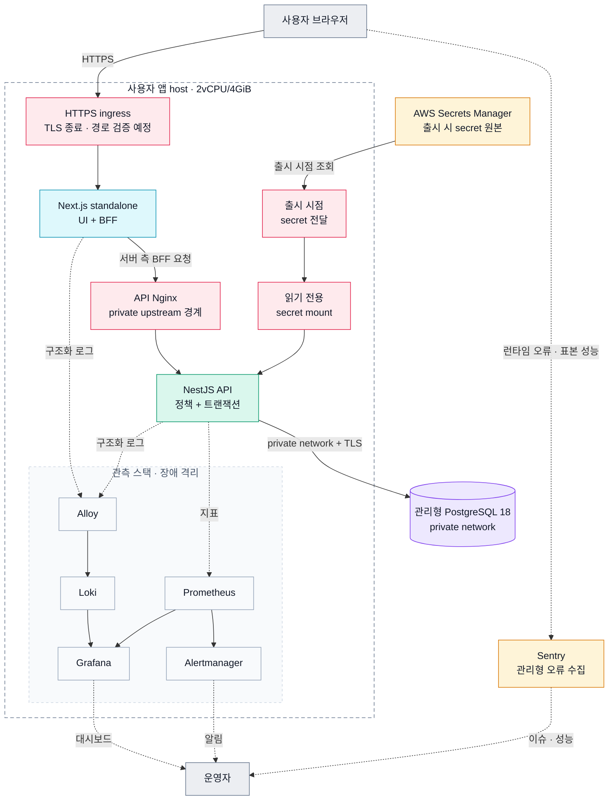

# Production runtime topology

## 책임

이 문서는 돔두리의 production runtime 배치 결정과 변경 근거를 소유한다. 지금 적용한 resource의 종류와 상태는
[Production environment](../../deploy/production-environment.md), 지금 청구되는 단가와 월 금액은
[서버 비용](../../deploy/server-costs.md)이 소유한다. Release gate가 쓰는 target 입력(container resource 값, 이후 단계
planning budget)과 release 결과는 infrastructure-target readiness/evidence가 소유하고, secret·DB·ingress·rollback
불변 조건은 [Production runtime safety](../../policies/production-runtime-safety.md)가 소유한다. 식별자는
[식별자 규칙](../../deploy/README.md#식별자-규칙)을 따른다.

## 지금 Web 단계

지금은 사용자 Web(Landing)만 공개하는 Web 단계다. API 단계를 위해 managed PostgreSQL과 secret 묶음을 만들었지만 API는 아직
배포하지 않았다. 관측 stack과 BackOffice는 없다.
Resource 종류·상태와 확인하는 Owner console 위치는 [Production environment](../../deploy/production-environment.md)가
소유하고, 이 절은 배치만 적는다.

```text
Route 53 dormduri.com (apex, www → apex redirect)
└── Lightsail host 4 GB (서울, static IP, firewall 80·443만)
    └── containerized nginx ingress (HTTPS 종료, Let's Encrypt)
        └── Web (Next.js standalone, UI + BFF)

RDS for PostgreSQL 18 (서울, private, Lightsail VPC peering으로 host에서만 5432)   ← API 단계에서 연결

GitHub Actions web-cd (main, production 승인)
├── build → ECR 비공개 dormduri/web·dormduri/ingress (digest, SBOM attestation manifest)
└── deploy → Systems Manager Run Command(document dormduri-web-deploy) → host가 ECR에서 digest로 pull
```

- 공개 진입: `dormduri.com` apex·`www` A record가 host static IP를 가리킨다. Canonical Web host는 apex이고 `www`는
  apex로 redirect한다. Firewall은 80·443만 열고 22는 닫는다.
- TLS: host의 containerized nginx가 Let's Encrypt 인증서로 HTTPS를 종료한다(certbot HTTP-01 webroot 갱신, CAA, HSTS).
- 배포 전달: host는 Systems Manager hybrid managed node이고, CD(`web-cd.yml`)가 OIDC deploy role로 document
  `dormduri-web-deploy`를 배포 대상 tag에 보낸다. Host는 host role로 ECR에서 digest 쌍을 받아 compose로 올리고 health·내부
  smoke가 실패하면 직전 쌍으로 되돌린다. SSH는 쓰지 않는다. 절차는
  [Web 단계 배포](../../../infra/runbooks/release/web-stage-deploy.md)다.
- 지금 상태: Landing을 공개하고 있다. 마지막 배포 기록은 [Production environment](../../deploy/production-environment.md#지금-상태)가 적는다.
- 외부 가용성: Route 53 HTTPS health check → `us-east-1` CloudWatch alarm → SNS email 구독. 흐름은
  [Observability topology](./observability-topology.md#지금-web-단계)가 적는다.
- 메일: SES(서울) domain identity와 구성 세트가 있고 계정은 sandbox다. 메일을 보내는 API는 아직 없다. 준비·시험 절차는
  [SES setup checklist](../../../infra/aws/ses-setup-checklist.md)가 소유한다.
- 이 단계는 아래 이후 목표의 User App host에 ingress와 Web만 먼저 두는 단계다. Host 크기(4 GB)와 ingress 하나에서
  HTTPS를 종료하는 방식은 이후 목표와 같다.

## 이후 목표

API 단계부터 BackOffice 출시까지의 목표 배치다. 아래 결정은 2026-08-11에 정했고, 각 단계의 준비 작업이 실제 구성으로
옮기며 그때 위 [지금 Web 단계](#지금-web-단계) 절과 [Production environment](../../deploy/production-environment.md)를
고친다. 아직 정하지 않은 입력은 [이후 단계에서 정할 입력](../../deploy/production-environment.md#이후-단계에서-정할-입력)에
있다.

### 결정

BackOffice 출시 전에는 **User App 4GiB host + private managed PostgreSQL**을 기준으로 준비한다.
BackOffice 출시 시에는 8GiB 단일 host로 합치지 않고 **User App 4GiB host + BackOffice 2GiB host +
private managed PostgreSQL**로 분리한다.

```text
User App host 4GiB
├── user nginx
├── Web
├── API
└── self-hosted observability stack

BackOffice host 2GiB
├── admin nginx
├── BackOffice Web
├── BackOffice API
└── observability collector

Managed PostgreSQL
```

### 목표 배포 구성도

아래 그림은 API·관측 stack·managed PostgreSQL을 더한 목표 구성이고 로컬 리허설의 기준이다. 지금 적용한 것은 위
[지금 Web 단계](#지금-web-단계)의 host와 ingress(점검 mode)이고 Web은 첫 배포 전이다. Web 단계에서 확인한 것은 apex의
TLS 종료다. 공개 ingress의 Web·API 경로 분리, provider 식별자와 네트워크, API·DB·secret 전달·관측 경로는 그 단계에서
실제 운영 환경으로 검증한 뒤 출시 근거로 확정한다.

다이어그램 색은 역할을 뜻한다: <b>청록</b> 사용자 화면 · <b>초록</b> 서버 애플리케이션 · <b>보라</b> 데이터베이스 · <b>주황</b> 관리형 클라우드 · <b>장미색</b> 보안·경계 · <b>회색</b> 사용자·운영 도구.



- 브라우저의 일반 UI·BFF 요청은 Next.js로 들어가고, BFF가 private API Nginx를 거쳐 NestJS를 호출한다.
- API는 private 관리형 PostgreSQL에 연결하며, DB는 사용자 앱 host의 4 GiB 자원 예산에 넣지 않는다.
- 운영 secret은 image나 Git에 넣지 않고, 출시 시점에 받아 읽기 전용 파일로 API container에 제공한다.
- 로그·지표·브라우저 신호는 각각 Loki·Prometheus·Sentry로 나누고, 관측 장애가 제품 요청을 막지 않게 한다.

### 선택 근거

- 사용자 traffic과 운영자 workload의 memory pressure 및 장애 영역을 분리한다.
- 사용자 제품과 BackOffice의 image, environment, deploy principal, ingress, health와 rollback을 독립시킨다.
- BackOffice 운영자 접근을 public 사용자 ingress와 분리하고 더 강한 network/capability 경계를 적용한다.
- BackOffice release가 사용자 제품의 무관한 rollout을 요구하지 않게 한다.
- 초기에는 운영 복잡도를 낮추기 위해 사용자 host에 bounded observability를 함께 두되, 실제 resource evidence가 나빠지면 별도 ops host 또는 managed service 전환을 다시 결정한다.

### Runtime 책임 경계

#### User App host

- 사용자 Web/API와 public ingress를 소유한다.
- API의 auth hash와 제품 transaction이 우선 resource owner다.
- Observability는 제품 요청을 방해하지 않는 limit와 fail-open 경계를 사용한다.
- BackOffice Web/API를 배치하지 않는다.

#### User public ingress와 BFF trust

초기 User App ingress는 upstream CDN/LB 없이 **containerized Nginx 하나에서 HTTPS/WSS를 종료**한다.
Public Web/API virtual host는 분리한다. Browser Web `/api/auth/*`는 Web/BFF로, direct API/Socket.IO는
API host로 들어간다. Web/BFF는 Web transit의 Web 주소만 허용하는 Nginx private listener를 거쳐 API로 간다(listener 주소를
transit에 bind하면 network가 container 시작 뒤 붙을 때 nginx가 뜨지 못해, 모든 주소에서 듣고 `allow`·`deny`로 거른다).

Public edge는 caller forwarded identity를 무시하고 원본 socket IP로 XFF를 덮어쓴다. Web은 단일 IP만
검증해 전달하고 private listener는 exact Web peer ACL 통과 후 그 identity를 유지한다. Private 경유
scheme/authority는 외부 HTTPS와 canonical API authority이며 내부 HTTP나 임의 Host로 바뀌지 않는다.

API와 Web은 각각 전용 transit만 사용하며 application port를 host에 publish하지 않는다. Nginx만
public/API/Web/observer network를 연결하고 upstream source를 명시적으로 bind한다. Observer는 exact
collector peer의 token-protected metrics만 중계하며 API trust CIDR에 observer network를 포함하지 않는다.
Public IPv6는 explicit dual-stack IPAM/listener로 지원하고 내부 transit은 IPv4를 유지할 수 있다.

API 단계 첫 구성은 user host ingress(`infra/deploy/user/ingress/`)에 private listener와 Web·API transit만 둔다. 공개 API host와
forwarding trust는 이용자 API를 여는 단계가 더한다([repository 구조](#repository와-deploy-구조-목표)).
실제 hostname/TLS/peer 관찰·network isolation·distinct-client/transport 검증 및 rollout/rollback
증거가 없으면 forwarding trust 활성화는 승인되지 않는다. Source/정적 검증은 release evidence를 대신하지 않는다.

#### BackOffice host

- 운영자 Web/API와 제한된 admin ingress만 소유한다.
- 사용자 session/capability를 그대로 재사용하지 않고 별도 admin authorization과 audit을 적용한다.
- 사용자 제품과 별도의 health, rollout과 previous-safe rollback 경로를 사용한다.
- 중앙 관측 stack으로 로그와 metric을 전달하되 raw 관측 query를 제품 API로 재노출하지 않는다.

#### Managed PostgreSQL

- User API와 BackOffice API가 같은 schema를 사용하더라도 runtime credential과 pool budget을 분리한다.
- Schema migration은 두 API가 경쟁해서 실행하지 않고 release pipeline의 단일 migration owner가 한 번만 수행한다.
- 대량 운영 조회·내보내기는 사용자 transaction pool과 timeout을 침범하지 않게 별도 budget을 사용한다.

### Repository와 deploy 구조 목표

```text
apps/
├── web/
├── api/
├── backoffice-web/
└── backoffice-api/

infra/
├── deploy/
│   ├── web/                 # app image: 사용자 Web(Dockerfile)
│   ├── api/                 # app image: API(Dockerfile·entrypoint·env manifest)
│   ├── user/                # User App host 한 대의 실행 묶음
│   │   ├── compose.yml      # Web 묶음 조각(web·ingress)
│   │   ├── ingress/         # host 전용 ingress image(nginx 설정·정적 화면)
│   │   ├── ssm/             # Web 배포 명령 원본·공통 lib와 그것으로 만든 SSM Command document
│   │   └── api/             # API 묶음 조각(api·migrate one-off)과 그 배포 명령·document
│   └── backoffice/          # BackOffice host 묶음(deployable이 생길 때)
├── aws/                     # 계정 resource: IAM·ECR 정책 template과 설정 checklist
└── rehearsal/               # local rehearsal 덮어쓰기
scripts/infra/user-host/     # user host 묶음의 구조 계약·ingress smoke·SSM document 생성
```

- App image 정의는 `infra/deploy/<app>/`에, 한 host에서 함께 도는 구성은 `infra/deploy/<host>/` 하나에 둔다. 그 host만
  쓰는 image(ingress)는 host 묶음 안에 둔다.
- 계정 단위 AWS resource(배포·publish·host role, OIDC 조건, ECR 수명 정책)의 정책 원본은 host 묶음이 아니라 `infra/aws/`에
  둔다. 실제 값(account·repository ID)은 placeholder로 두고 console에서 채운다.
- Local rehearsal은 운영 compose를 원본으로 쓰고 `infra/rehearsal/`의 덮어쓰기 파일로 image·host 경로·publish port만
  바꾼다(profile `user-host-rehearsal`). 운영 구성을 rehearsal용으로 따로 복제하지 않는다.
- API 단계는 별도 host나 ingress를 두지 않는다. 같은 host 묶음 안에 API 조각(`infra/deploy/user/api/compose.yml`)과 그
  document를 따로 두어 Web과 API를 따로 배포·되돌린다. 두 조각은 compose project 하나로 합치고 document마다 자기 service만
  바꾼다. `ingress/`에는 private BFF 경로를 더한다. `infra/deploy/compose.api.yml`·`infra/deploy/nginx/`는 API 개발
  rehearsal(stress, full-stack)이 쓰는 후보로 남는다.
- BackOffice deployable이 생기기 전에는 빈 디렉터리나 가짜 compose를 만들지 않는다. 구현 시 caller, CI path filter, image
  inventory, environment manifest와 rollback 경계를 함께 이전한다.

## Capacity 근거와 변경 trigger

Release gate가 쓰는 container limit과 이후 단계 planning budget은
[`infrastructure-target-release-readiness.md`](../../../infra/runbooks/release/components/infrastructure-target/readiness.md)가
소유하고, 지금 청구되는 단가와 월 금액은 [서버 비용](../../deploy/server-costs.md)이 소유한다. Local 연결·resource 회귀 절차는
[`full-stack-local-infrastructure.md`](../../../infra/runbooks/rehearsal/full-stack.md)가
소유한다.

다음 조건 중 하나가 확인되면 topology를 새 decision으로 재검토한다.

- User host의 sustained CPU, memory, disk 또는 latency가 release threshold를 넘는다.
- Observability resource가 제품 요청의 headroom을 침범한다.
- BackOffice query가 사용자 DB pool 또는 transaction latency를 침범한다.
- 단일 host 장애 영역이나 operator 접근 경계가 승인된 RTO/RPO를 만족하지 못한다.
- Multi-instance, managed observability, read replica 또는 별도 analytics store가 비용 대비 더 유리하다는 evidence가 생긴다.

## 변경 이력

| 날짜       | 변경 내용                                                                                                                    |
| ---------- | ---------------------------------------------------------------------------------------------------------------------------- |
| 2026-08-11 | User App 4GiB와 미래 BackOffice 2GiB를 분리하고 managed PostgreSQL을 공유하는 topology를 확정했다.                           |
| 2026-10-20 | 루트 README에 있던 출시 전 배포 구성도와 설명을 이 문서로 옮겼다.                                                            |
| 2026-10-31 | 지금 적용한 Web 단계 배치를 첫 절로 두고 기존 결정·구성도·책임 경계를 이후 목표 절로 옮겼다.                                 |
| 2026-11-03 | 구조 목표를 app image·host 묶음·계정 resource·rehearsal 덮어쓰기로 나누고 API 단계가 user host 묶음에 합쳐지게 했다.         |
| 2026-11-10 | API 묶음을 같은 host 묶음 안의 따로 배포하는 조각으로 두고, private listener를 주소 허용 방식으로, 지금 단계에 RDS를 더했다. |
