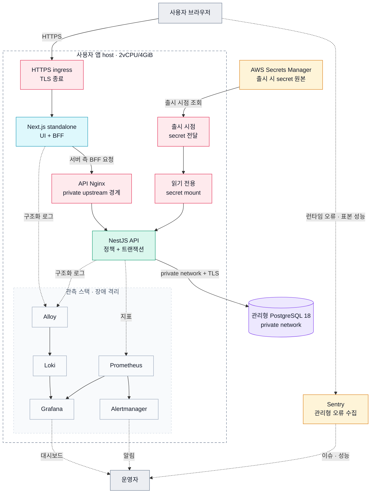

# Production runtime topology

## 책임

이 문서는 돔두리의 production runtime 배치 결정과 변경 근거를 소유한다. 지금 적용한 resource의 종류와 상태는
[Production environment](../../deploy/production-environment.md), 지금 청구되는 단가와 월 금액은
[서버 비용](../../deploy/server-costs.md)이 소유한다. Release gate가 쓰는 target 입력(container resource 값, 이후 단계
planning budget)과 release 결과는 infrastructure-target readiness/evidence가 소유하고, secret·DB·ingress·rollback
불변 조건은 [Production runtime safety](../../policies/production-runtime-safety.md)가 소유한다. 식별자는
[식별자 규칙](../../deploy/README.md#식별자-규칙)을 따른다.

## 지금 Web 단계

지금은 사용자 Web만 공개하는 Web 단계의 배포 준비 상태다. API, managed PostgreSQL, 관측 stack과 BackOffice는 아직 없다.
Resource 종류·상태와 확인하는 Owner console 위치는 [Production environment](../../deploy/production-environment.md)가
소유하고, 이 절은 배치만 적는다.

```text
Route 53 dormduri.com (apex, www → apex redirect)
└── Lightsail host 4 GB (서울, static IP, firewall 80·443만)
    └── containerized nginx ingress (HTTPS 종료, Let's Encrypt)
        └── Web (Next.js standalone, UI + BFF)
```

- 공개 진입: `dormduri.com` apex·`www` A record가 host static IP를 가리킨다. Canonical Web host는 apex이고 `www`는
  apex로 redirect한다. Firewall은 80·443만 열고 22는 닫는다.
- TLS: host의 containerized nginx가 Let's Encrypt 인증서로 HTTPS를 종료한다(certbot HTTP-01 webroot 갱신, CAA, HSTS).
- 지금 상태: host는 점검 mode(nginx 503 응답)이고 Web image는 아직 배포되지 않았다.
- 외부 가용성: Route 53 HTTPS health check → `us-east-1` CloudWatch alarm → SNS email 구독. 흐름은
  [Observability topology](./observability-topology.md#지금-web-단계)가 적는다.
- 메일: SES(서울) domain identity와 구성 세트가 있고 계정은 sandbox다. 메일을 보내는 API는 아직 없다. 준비·시험 절차는
  [SES setup checklist](../../../infra/aws/ses-setup-checklist.md)가 소유한다.
- 이 단계는 아래 이후 목표의 User App host에서 Web과 ingress만 먼저 올린 것이다. Host 크기(4 GB)와 ingress 하나에서
  HTTPS를 종료하는 방식은 이후 목표와 같다.

## 이후 목표

API 단계부터 BackOffice 출시까지의 목표 배치다. 아래 결정은 2026-08-11에 정했고, 각 단계의 준비 작업이 실제 구성으로
옮기며 그때 위 [지금 Web 단계](#지금-web-단계) 절과 [Production environment](../../deploy/production-environment.md)를
고친다. 아직 정하지 않은 입력은 [이후 단계에서 정할 입력](../../deploy/production-environment.md#이후-단계에서-정할-입력)에
있다.

### 결정

BackOffice 출시 전에는 **User App 4GiB host + private managed PostgreSQL**을 기준으로 준비한다.
BackOffice 출시 시에는 8GiB 단일 host로 합치지 않고 **User App 4GiB host + BackOffice 2GiB host +
private managed PostgreSQL**로 분리한다.

```text
User App host 4GiB
├── user nginx
├── Web
├── API
└── self-hosted observability stack

BackOffice host 2GiB
├── admin nginx
├── BackOffice Web
├── BackOffice API
└── observability collector

Managed PostgreSQL
```

### 목표 배포 구성도

아래 그림은 API·관측 stack·managed PostgreSQL을 더한 목표 구성이고 로컬 리허설의 기준이다. 지금 적용한 것은 위
[지금 Web 단계](#지금-web-단계)의 host·ingress·Web뿐이다. API·DB·secret 전달·관측 경로는 그 단계에서 실제 운영 환경으로
검증한 뒤 출시 근거로 확정한다.

다이어그램 색은 역할을 뜻한다: <b>청록</b> 사용자 화면 · <b>초록</b> 서버 애플리케이션 · <b>보라</b> 데이터베이스 · <b>주황</b> 관리형 클라우드 · <b>장미색</b> 보안·경계 · <b>회색</b> 사용자·운영 도구.



- 브라우저의 일반 UI·BFF 요청은 Next.js로 들어가고, BFF가 private API Nginx를 거쳐 NestJS를 호출한다.
- API는 private 관리형 PostgreSQL에 연결하며, DB는 사용자 앱 host의 4 GiB 자원 예산에 넣지 않는다.
- 운영 secret은 image나 Git에 넣지 않고, 출시 시점에 받아 읽기 전용 파일로 API container에 제공한다.
- 로그·지표·브라우저 신호는 각각 Loki·Prometheus·Sentry로 나누고, 관측 장애가 제품 요청을 막지 않게 한다.

### 선택 근거

- 사용자 traffic과 운영자 workload의 memory pressure 및 장애 영역을 분리한다.
- 사용자 제품과 BackOffice의 image, environment, deploy principal, ingress, health와 rollback을 독립시킨다.
- BackOffice 운영자 접근을 public 사용자 ingress와 분리하고 더 강한 network/capability 경계를 적용한다.
- BackOffice release가 사용자 제품의 무관한 rollout을 요구하지 않게 한다.
- 초기에는 운영 복잡도를 낮추기 위해 사용자 host에 bounded observability를 함께 두되, 실제 resource evidence가 나빠지면 별도 ops host 또는 managed service 전환을 다시 결정한다.

### Runtime 책임 경계

#### User App host

- 사용자 Web/API와 public ingress를 소유한다.
- API의 auth hash와 제품 transaction이 우선 resource owner다.
- Observability는 제품 요청을 방해하지 않는 limit와 fail-open 경계를 사용한다.
- BackOffice Web/API를 배치하지 않는다.

#### User public ingress와 BFF trust

초기 User App ingress는 upstream CDN/LB 없이 **containerized Nginx 하나에서 HTTPS/WSS를 종료**한다.
Public Web/API virtual host는 분리한다. Browser Web `/api/auth/*`는 Web/BFF로, direct API/Socket.IO는
API host로 들어간다. Web/BFF는 Web transit에만 bind한 Nginx private listener를 거쳐 API로 간다.

Public edge는 caller forwarded identity를 무시하고 원본 socket IP로 XFF를 덮어쓴다. Web은 단일 IP만
검증해 전달하고 private listener는 exact Web peer ACL 통과 후 그 identity를 유지한다. Private 경유
scheme/authority는 외부 HTTPS와 canonical API authority이며 내부 HTTP나 임의 Host로 바뀌지 않는다.

API와 Web은 각각 전용 transit만 사용하며 application port를 host에 publish하지 않는다. Nginx만
public/API/Web/observer network를 연결하고 upstream source를 명시적으로 bind한다. Observer는 exact
collector peer의 token-protected metrics만 중계하며 API trust CIDR에 observer network를 포함하지 않는다.
Public IPv6는 explicit dual-stack IPAM/listener로 지원하고 내부 transit은 IPv4를 유지할 수 있다.

구현 owner와 renderer 입력·고정 Compose 순서는 [deploy candidate 계약](../../../infra/deploy/README.md#single-public-ingress-forwarding-trust-target)을
따른다. 실제 hostname/TLS/peer 관찰·network isolation·distinct-client/transport 검증 및 rollout/rollback
증거가 없으면 forwarding trust 활성화는 승인되지 않는다. Source/정적 검증은 release evidence를 대신하지 않는다.

#### BackOffice host

- 운영자 Web/API와 제한된 admin ingress만 소유한다.
- 사용자 session/capability를 그대로 재사용하지 않고 별도 admin authorization과 audit을 적용한다.
- 사용자 제품과 별도의 health, rollout과 previous-safe rollback 경로를 사용한다.
- 중앙 관측 stack으로 로그와 metric을 전달하되 raw 관측 query를 제품 API로 재노출하지 않는다.

#### Managed PostgreSQL

- User API와 BackOffice API가 같은 schema를 사용하더라도 runtime credential과 pool budget을 분리한다.
- Schema migration은 두 API가 경쟁해서 실행하지 않고 release pipeline의 단일 migration owner가 한 번만 수행한다.
- 대량 운영 조회·내보내기는 사용자 transaction pool과 timeout을 침범하지 않게 별도 budget을 사용한다.

### Repository와 deploy 구조 목표

```text
apps/
├── web/
├── api/
├── backoffice-web/
└── backoffice-api/

infra/deploy/
├── user/
│   └── compose.yml
└── backoffice/
    └── compose.yml
```

BackOffice deployable이 생기기 전에는 빈 디렉터리나 가짜 compose를 만들지 않는다. 구현 시 caller,
CI path filter, image inventory, environment manifest와 rollback 경계를 함께 이전한다.

## Capacity 근거와 변경 trigger

Release gate가 쓰는 container limit과 이후 단계 planning budget은
[`infrastructure-target-release-readiness.md`](../../../infra/runbooks/release/components/infrastructure-target/readiness.md)가
소유하고, 지금 청구되는 단가와 월 금액은 [서버 비용](../../deploy/server-costs.md)이 소유한다. Local 연결·resource 회귀 절차는
[`full-stack-local-infrastructure.md`](../../../infra/runbooks/rehearsal/full-stack.md)가
소유한다.

다음 조건 중 하나가 확인되면 topology를 새 decision으로 재검토한다.

- User host의 sustained CPU, memory, disk 또는 latency가 release threshold를 넘는다.
- Observability resource가 제품 요청의 headroom을 침범한다.
- BackOffice query가 사용자 DB pool 또는 transaction latency를 침범한다.
- 단일 host 장애 영역이나 operator 접근 경계가 승인된 RTO/RPO를 만족하지 못한다.
- Multi-instance, managed observability, read replica 또는 별도 analytics store가 비용 대비 더 유리하다는 evidence가 생긴다.

## 변경 이력

| 날짜       | 변경 내용                                                                                          |
| ---------- | -------------------------------------------------------------------------------------------------- |
| 2026-08-11 | User App 4GiB와 미래 BackOffice 2GiB를 분리하고 managed PostgreSQL을 공유하는 topology를 확정했다. |
| 2026-10-20 | 루트 README에 있던 출시 전 배포 구성도와 설명을 이 문서로 옮겼다.                                  |
| 2026-10-31 | 지금 적용한 Web 단계 배치를 첫 절로 두고 기존 결정·구성도·책임 경계를 이후 목표 절로 옮겼다.       |
